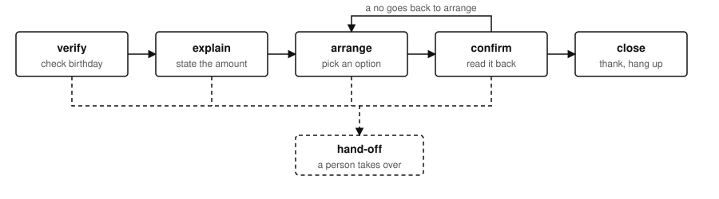

# nudge-engine

The backend for Nudge, a voice agent that phones a borrower before a loan payment is due, reminds them, asks what they plan to do, and records the promise.

It runs against a fake lender and made-up borrowers. Nothing here touches real money or real customers. The website that goes with it is the `nudge` repo.


## The idea

The model decides what to say and which tool to call. Plain code decides what is allowed. The prompt asks for good behaviour, but nothing depends on the model obeying it.

- The model only sees the tools that fit the current step of the call.
- Every tool call goes through one function (`run_tool` in `engine/agent.py`), which checks the step and the rules first.
- Every reply is checked before it is spoken: no digits, nothing threatening, no loan details before the caller is verified, and every amount and date must be copied word for word from a tool result.
- Nothing is saved until the caller answers a read-back sentence that the code wrote. A repeated "yes" cannot save twice.
- "Stop calling me" and "let me speak to a person" are handled by code, not by the model.



## What is in here

```
engine/    the agent, the rules, the API, phone calls
deploy/    what runs on Modal: llm.py (the brain), tts.py (the voice), api.py
evals/     scripted borrowers, speed benchmarks and the report that turns them into tables
db/        database migrations
scripts/   check_services.py, to see that your keys and URLs work
notebooks/ the Colab notebook that deploys and tests each piece
tests/     unit tests, no keys and no GPU needed
docs/      deploying, and phone calls
```

If you read one file, read `engine/agent.py`. It is one file, top to bottom.

## Run it on your machine

You need Python 3.12, [uv](https://docs.astral.sh/uv/) (the Python equivalent of npm), and a Postgres database. A free Neon database works.

```
uv sync
cp .env.example .env     # fill in DATABASE_URL and API_KEY to start
uv run python -m engine.seed --init-schema
uv run uvicorn engine.main:build_app --factory --reload --port 8000
```

Open http://localhost:8000/health. The seed command creates the tables and 45 fake borrowers.

To have a real conversation you also need the models. The brain and the voice need GPUs, so they run on Modal. The API can run on your machine and point at them. `docs/deploy.md` has the steps.

The tests need none of that:

```
uv run pytest
```

## Deploy

`docs/deploy.md`. In short: the models and the API run on Modal, and a push to `main` redeploys them after the tests pass. Deploying never starts a GPU, only a real request does.

## Evals

```
uv run modal run evals/run.py                              # eight scripted borrowers, once
uv run modal run evals/run.py --runs 5 --label baseline    # five runs each, saved
```

Eight scripted borrowers talk to the real deployed model: a cooperative one, one who fails verification, one who says stop, one who wants a person, one who lost their job, one who says they already paid, one who tries to trick the agent, and one who offers too little.

Two scores, kept apart. **Rules** are what must never break: no digit spoken, nothing about the loan before verification, at most one promise. A broken rule fails the run. **Task** is whether the call reached the right outcome with the right tools; it is reported with a 95% interval, because "5 of 5" is not the same as "100%". The checks are plain code, not an LLM judge, so the same call scores the same way every time.

The method (scripted multi-turn calls, per-turn tool checks, latency percentiles) comes from [aiewf-eval](https://github.com/kwindla/aiewf-eval). We kept only the part that fits a small agent.

## Performance

```
uv run modal run evals/bench.py::llm --label rtx6000-bf16 --gpu RTX-PRO-6000 --price <usd per hour>
uv run modal run evals/bench.py::tts --label l4 --gpu L4 --price <usd per hour>
uv run python -m evals.report --write      # builds docs/performance.md
```

The brain benchmark replays the five requests of a real call (real prompt, real tools) with 1, 4, 8 and 16 calls at once, and reports time to first token (P50/P95/P99, goal under 700 ms), tokens per second, requests per second, the prefix-cache hit rate, the cost per 1,000 requests, and the cold start. `--tools fixed` sends all eight tools on every request, so you can show what the per-state tool lists buy. Chatterbox cannot stream, so the voice benchmark times whole sentences and reports the real-time factor.

The numbers are in `docs/performance.md`, made by the command above from the files in `evals/results/`. Nothing is typed by hand. If that file says "No results yet", the benchmarks have not been run.

## Phone calls

Twilio can ring a number and the same agent talks to whoever answers. Only numbers you list in `ALLOWED_NUMBERS` can be called. See `docs/phone.md`.

## Not done yet

- A scheduler that decides who to call and when.
- Reconciling payments against promises.
- A real lender integration. The lender here is a few database tables.
- Languages other than English.
- A proper latency report. The terminal and Modal logs show timings, nothing more.
