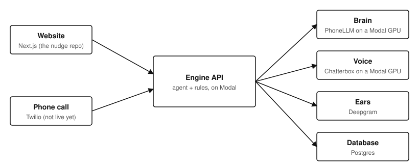
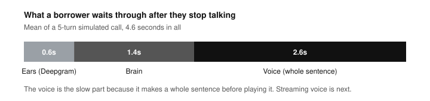
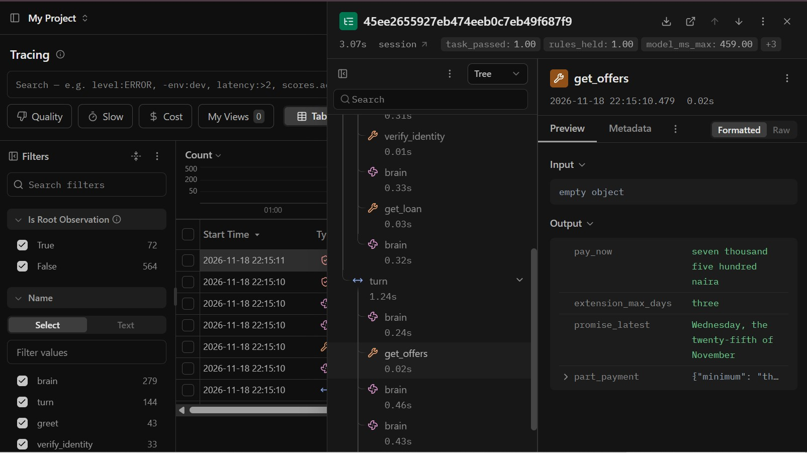

# nudge-finance

**A voice agent that phones borrowers in Nigeria before their loan is due, reminds them politely, and records what they promise.**

[](https://colab.research.google.com/github/aidyai/nudge-engine/blob/main/notebooks/nudge_engine_setup.ipynb)

Everything here runs against a fake lender and made-up borrowers. No real money, no real customers.

## The problem

Lenders in Nigeria (digital lenders, microfinance banks, cooperatives) lose money when borrowers pay late. A text message is easy to ignore. A human call centre is expensive, uneven from one agent to the next, and the pressure to recover money pushes some callers into threats and shaming, which hurts the borrower and the lender's name.

A call placed a few days **before** the due date, by someone calm who knows the amount and the date, and who gets a clear promise back, is the cheapest point to prevent a late payment. nudge-finance is that call, with an AI voice.

The hard part is not making a voice talk. It is making one a lender can trust:

- It must be sure it is speaking to the right person **before** it says a naira amount.
- It must never invent an amount or a date.
- It must stop when the borrower says stop, and hand over to a human when asked.
- It must never save a promise the borrower did not clearly agree to.

## What a call looks like

An illustrative example, in the agent's real style:

```
AGENT: Hello, this is Idara, an automated assistant from Acme Microfinance. Am I speaking with Musa Bello?
YOU:   Yes, speaking.
AGENT: Thanks, Musa. Could I please have your day and month of birth to make sure it's you?
YOU:   The twenty-first of January.
AGENT: Thank you, Musa. You have twenty-five thousand naira due on Friday, the thirteenth of November. When can you pay?
YOU:   I can pay on Friday.
AGENT: To confirm: you will pay twenty-five thousand naira on Friday, the thirteenth of November. Is that right?
YOU:   Yes, that is right.
AGENT: Thank you. Your promise is saved. Goodbye.
```

A company types in who to call on the website (`nudge` repo), then takes the call from the browser. A spreadsheet upload for many borrowers is planned, not built.

## How it works



The model decides what to say and which tool to call. **Plain code decides what is allowed.** The prompt asks for good behaviour, but nothing depends on the model obeying it.

- The model only sees the tools that fit the current step of the call.
- Every tool call goes through one function (`run_tool` in `engine/agent.py`), which checks the step and the rules first.
- Every reply is checked before it is spoken: no digits, nothing threatening, no loan details before the caller is verified, and every amount and date copied word for word from a tool result.
- Nothing is saved until the caller answers a read-back sentence that the code wrote. A repeated "yes" cannot save twice.
- "Stop calling me" and "let me speak to a person" are handled by code, not by the model.


The live call uses [Pipecat](https://github.com/pipecat-ai/pipecat): the browser streams the microphone, Silero detects speech, Deepgram transcribes, smart-turn-v3 decides when the borrower has finished, and the agent answers in a cloned or default voice (Chatterbox). The brain is a small open model (PhoneLLM Mini) served with vLLM. Both run on [Modal](https://modal.com).

## Results

Measured on Modal on 17 and 18 November 2026, with one RTX PRO 6000 for the brain and one A10 for the voice. The full tables are in [`docs/performance.md`](docs/performance.md). They are built by a command from the saved files in `evals/results/`, not typed by hand.

### The agent follows its rules

8 scripted borrowers, 5 runs each: a happy one, a wrong birthday, someone who says stop, someone who asks for a person, someone who lost their job, someone who says they already paid, someone who tries to trick the agent, and someone who offers too little.

**Every rule held in 40 of 40 runs, and every call reached the right outcome.** Five runs per scenario is a small sample (95% interval 57 to 100% per scenario), so the honest claim is "40 of 40 so far".

### The brain is fast

Goal: first token in under 700 ms. One call is the 5 requests the agent really makes.

| calls at once | first token p50 / p95 | tokens/s | USD per 1k requests |
|---|---|---|---|
| 1 | 83 / 92 ms | 185 | 0.201 |
| 4 | 165 / 193 ms | 140 | 0.078 |
| 8 | 238 / 271 ms | 129 | 0.050 |
| 16 | 308 / 466 ms | 71 | 0.038 |

The prefix-cache hit rate is 0% at every level: the five requests of a call share a long prompt and none of it is reused. We have a guess (the model's hybrid architecture limits vLLM's prefix caching) but have not tested it.

### The voice is the slow part

Chatterbox Turbo makes a whole sentence before it plays, so the borrower waits for all of it.



| at once | latency p50 / p95 | real-time factor | USD per 1k sentences |
|---|---|---|---|
| 1 | 1.3 / 2.4 s | 0.47 | 0.435 |
| 2 | 2.3 / 4.2 s | 0.90 | 0.397 |
| 4 | 6.0 / 12.9 s | 2.20 | 0.508 |

Real-time factor under 1 means faster than speech. One A10 serves one or two calls at a time. On an L4 a single caller got the same latency (1.35 s) for less money ($0.322 per 1k sentences); the A10 only wins under load (6.0 s against 8.3 s at four at once).

### Every call is traced

Every call and every eval run is traced in [Langfuse](https://langfuse.com): one session per call, a step for each turn, each brain call and each tool call, and the scores `task_passed`, `rules_held` and `model_ms_max` on the trace. This is one eval run (3.07 s end to end; each brain call took 0.24 to 0.46 s, each tool call 0.01 to 0.03 s):



### Known limits

- The voice does not stream, so a turn takes 4 to 5 seconds. Streaming voice is the next thing to build.
- A sleeping brain takes 9 to 29 minutes to wake (most of it is compiling kernels), so it is kept awake during a call.
- The first simulated phone call ended early: Deepgram misheard the pretend borrower's "21 January" as "2000 January". The test script now says dates in words and needs a re-run, so `evals/results/call-call.json` is out of date.
- Not measured yet: a live browser call against the deployed engine, a quantized brain (fp8, nvfp4), cold starts with the memory snapshot, and the backchannel detector ("mm-hm" must not interrupt).
- English only. No real phone line yet: the phone route and its allow-list are built and tested, but a free Twilio trial cannot ring Nigerian numbers (`docs/phone.md`).

## Try it

**In Colab (no GPU needed):** open the notebook with the badge above. It deploys everything to your Modal account, makes a simulated call, runs the evals and benchmarks, builds the tables, and has a Stop cell so the GPUs do not keep billing. You need keys for Modal, Deepgram, Hugging Face, Langfuse and a Postgres database (a free Neon one works).

**On your machine** (the tests need no keys and no GPU):

```
uv sync
cp .env.example .env     # fill in DATABASE_URL and API_KEY to start
uv run python -m engine.seed --init-schema
uv run uvicorn engine.main:build_app --factory --reload --port 8000
uv run pytest
```

Then open http://localhost:8000/health. To have a real conversation, deploy the models: [`docs/deploy.md`](docs/deploy.md). How live calls, tracing, evals and the benchmarks work: [`docs/internals.md`](docs/internals.md).

## What is in here

```
engine/    the agent, the rules, the API, live browser calls, phone calls, tracing
deploy/    what runs on Modal: the brain (llm.py), the voice (tts.py), the API (api.py)
evals/     scripted borrowers, speed benchmarks, the report that turns them into tables, saved results
db/        database migrations
scripts/   one-command setup, simulated calls (voice and streaming) without a phone
notebooks/ the Colab notebook
tests/     unit tests
docs/      deploying, how it works inside, phone calls, results, diagrams
```

If you read one file, read `engine/agent.py`. It is one file, top to bottom.

## Not done yet

- Uploading a spreadsheet of borrowers, and a scheduler that decides who to call and when.
- Reconciling payments against promises, and a real lender integration (the lender here is a few database tables).
- Nigerian languages and Pidgin. The agent speaks English only.
- Streaming voice, to cut the wait.

MIT licence.
